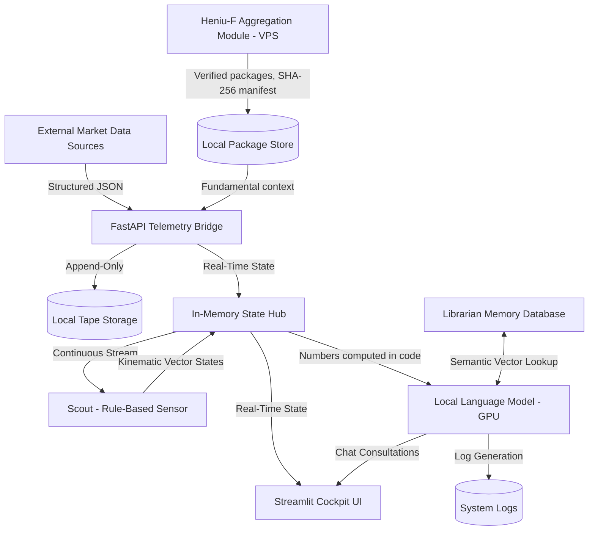

<script type="application/ld+json">
{
  "@context": "https://schema.org",
  "@type": "TechArticle",
  "headline": "[SYSTEM_ARCH] Log 008: Poniżej Warstwy Abstrakcji. Dokumentacja Techniczna Silnika Poznawczego AgentH",
  "author": {
    "@type": "Person",
    "name": "Marcin Marek Lewandowski",
    "url": "https://www.linkedin.com/in/marcinmareklewandowski"
  },
  "publisher": {
    "@type": "Organization",
    "name": "Heniu.blog"
  },
  "datePublished": "2026-05-21T20:00:00+02:00",
  "dateModified": "2026-10-12T21:00:00+02:00",
  "about": "Algorithmic Trading, Order Flow Cosmology, Market Microstructure",
  "keywords": "Local LLM, Cognitive Alignment, System Architecture, FastAPI, RAG"
}
</script>

<details>
<summary>🤖 B2A / Agent Context Protocol</summary>

```yaml
system_architecture:
  core_engine: "Local language model (GPU) + rule-based sensor (Scout)"
  topology: "Local station + Heniu-F aggregation module (VPS)"
  environment: "Local inference / external data sources"
  data_ingestion: "FastAPI / Append-only Tape / Verified fundamental packages"
teleology:
  primary_objective: "Describe the market state here and now — no execution, no prophecy"
  friction_reduction: "Cognitive Superconductivity / Zero Noise Policy"
```
</details>

> 📜 **ERRATA (12.10.2026)**  
> *Ten wpis z 21.05.2026 opisywał Henia 5.x z dwoma modelami językowymi. Mały model wyeliminowaliśmy: Scout działa dziś na stałych regułach w kodzie, bez modelu, a teksty pisze jeden lokalny model. Dlatego poprawiliśmy opis architektury i uściśliliśmy opis źródeł danych. Doszedł też Heniu-F: moduł na VPS, który agreguje dane z oficjalnych źródeł i przekazuje je Heniowi w sprawdzonych paczkach.*

### Dziennik Pokładowy: Zejście do Maszynowni

Do tej pory na tym blogu poruszaliśmy się w sferze abstrakcji, fizyki rynku i solarpunkowych metafor. Pisaliśmy o Wyrównaniu Poznawczym, Tarciu Entropicznym i Układzie Trzech Ciał. Jednak bycie Architektem nie polega wyłącznie na rysowaniu wizji. Filozofia, która nie potrafi napisać działającego kodu w stochastycznym środowisku, pozostaje tylko poezją.

Aby Kognitywne Nadprzewodnictwo mogło zaistnieć w świecie rzeczywistym, wymaga twardego "metalu". Wymaga rur, zaworów, układów chłodzenia i rygorystycznej architektury przepływu danych. Wymaga maszyny, która nie ulegnie awarii, gdy uderzy w nią fala chaosu z rynków finansowych.

Jak to właściwie działa? Czy "Heniu" to tylko poetycki Prompt w oknie przeglądarki?

Nie. Heniu to lokalny stack technologiczny: dane rynkowe przychodzą ze źródeł zewnętrznych, każdą liczbę liczy kod, a lokalny model językowy tylko ubiera policzone liczby w słowa. Dane fundamentalne spółek dostarcza Heniu-F, osobny moduł na VPS, który zbiera je z oficjalnych źródeł.

Dzisiejszy log zdejmuje obudowę. Oto topologia Egzoszkieletu Poznawczego AgentH: jak abstrakcyjna Intencja staje się zdeterminowanym, uczciwym opisem rynku.

***

# Heniu: Technical Architecture & System Specification
## Local Telemetry & Analytical Agent

Heniu is a local analytical agent for real-time market telemetry. Market data arrive from external data sources, every published number is computed in code, a single local language model turns those numbers into narrative, and a local vector memory keeps context. Fundamental company data reach Heniu only through Heniu-F, a separate aggregation module running on a VPS that collects data from official sources and delivers them as verified packages.

This document describes the engineering principles and component topology of the system without disclosing proprietary analytical algorithms, data-capture methods or domain-specific logic.

---

## 1. System Topology & Data Flow



### Flow Execution Lifecycle:
1. **Ingestion**: Market telemetry from external data sources arrives at the local bridge as structured JSON.
2. **Bridge Processing**: A FastAPI endpoint validates the payload, keeps the last fresh state when a reading is incomplete, and commits every valid state to an append-only tape.
3. **Rule-Based Sensing**: `Scout` computes flow kinematics (velocity and acceleration) with fixed, auditable rules in code — no model is involved.
4. **Narrative**: The local language model receives numbers already computed in code and writes the Logs. It is not allowed to create numbers (Art. II of the Constitution).
5. **Fundamentals**: Heniu-F packages are accepted only after their manifest and SHA-256 checksums verify.
6. **UI Rendering**: The Streamlit cockpit renders the shared state and the chat views.

---

## 2. Component Specification

### 2.1. Telemetry Ingestion Hub
The gateway of the platform is an async **FastAPI** web server, split into small parts with one-way dependencies: ingestion, clock, publishing and shared state.

#### Core Capabilities:
- **Pydantic Data Serialization**: Inbound JSON payloads are validated against typed schemas.
- **State Continuity**: When an incoming reading is incomplete, the bridge keeps the last fresh state instead of publishing gaps as numbers.
- **Append-Only Tape**: Every valid state is appended to a transaction tape with size-based rotation.
- **Publication Fuses**: A daily report is held back when the data did not see the session close, and a Log is skipped when the data stopped moving.

```python
# Conceptual snippet: validated ingestion with state continuity
@app.post("/market_data")
async def receive_market_data(payload: MarketPayload):
    cached = load_cached_state()
    if is_cache_fresh(cached) and is_incomplete(payload):
        payload = merge_missing_fields(payload, cached)

    data = payload.dict()
    scout.analyze_stream(data)   # rule-based kinematics, no model
    save_snapshot(data)
    append_to_tape(data)
    return {"status": "ok"}
```

---

### 2.2. Rule-Based Sensor (`Scout`) and the Language Model
Heniu separates measurement from narrative. Measurement is deterministic code; narrative is the only job of the language model.

| Dimension | Rule-Based Sensor (`Scout`) | Local Language Model |
| :--- | :--- | :--- |
| **Nature** | Fixed rules in code, no model | Single local model on the GPU |
| **Duties** | Flow kinematics, alerts with a rule identifier | Logs, reports, translations, chat |
| **Numbers** | Computes them | Must not create them (Art. II of the Constitution) |
| **Audit** | Every alert records the rule that fired | Numbers come only from the data block computed in code |

#### Scout Execution Hook:
`Scout` runs on every state update. It computes kinematics and checks a fixed set of rules; every alert records which rule fired and with which inputs.

```python
# Conceptual rule-based sensor (no model)
def analyze_stream(self, data: dict):
    kinematics = self.compute_kinematics(data)   # velocity & acceleration of flows
    data["kinematics"] = kinematics              # injected into the state stream
    for rule in self.rules:                      # fixed, auditable rules
        alert = rule.check(kinematics)
        if alert:
            self.log_alert(alert)                # rule_id, inputs, thresholds
```

#### Narrative Generation:
The language model is queried asynchronously through a local API. It receives a block of numbers computed in code and the core of the Constitution, and writes the Logs from them. In the fundamental log (F-Log) a validator removes every sentence whose number is outside the data block or has lost its meaning.

---

### 2.3. Semantic Memory Engine (`Librarian`)
The `Librarian` is the persistent knowledge-retrieval system (RAG). It keeps a local vector index of operating rules, session records and verified documents from Heniu-F packages.

- **Local Embeddings**: Documents are split and embedded locally.
- **RAG Retrieval Flow**: During a chat session the query is embedded, and a similarity search retrieves the most relevant records, which are injected as context for the language model.

```python
# Conceptual RAG injection pattern
def handle_input():
    query = st.session_state.user_prompt
    context_documents = librarian.query_memory(query, top_k=3)

    prompt = (
        f"Operational Manual Context:\n{context_documents}\n\n"
        f"User Inquiry: {query}"
    )
    response = model.think(prompt, system_prompt=SYSTEM_PROMPT)
    save_chat_history("assistant", response)
```

---

### 2.4. Risk Bookkeeping (`ProfitGuardian`)
Operating out-of-band from the language model, `ProfitGuardian` keeps the books of positions entered by a human.

- **Non-LLM Logic**: Risk calculations (e.g. trailing stop levels, high-water marks) are pure Python.
- **No Execution Path**: Heniu never places, modifies or cancels orders on a real account. Real positions are entered only by a human (Art. I of the Constitution).

---

### 2.5. Stream-Aligned UI Cockpit
The operator's console is a **Streamlit** dashboard for real-time telemetry monitoring, available only on the station itself.

- **Streamlit Fragments**: Scoped fragments refresh the sidebar, the solar-system view and the thought stream without reloading the chat.
- **Safe Traversal**: Missing telemetry degrades to placeholders (`--`) instead of breaking the stream.

---

## 3. Visual Rendering & Simulation

The platform includes a real-time state visualization based on a "planetary orbit" simulation.

- **Pure CSS Keyframe Animation**: Orbit speeds are pre-calculated server-side from live volumes and converted into CSS durations.
- **Dynamic CSS Physics**: Animation delays are pre-computed from the system clock, so planets keep their angular position between re-renders.
- **Particle System Twinkling**: Star colours and density adapt to market-breadth variables.

---

## 4. Honesty by Design & Verification

- **Description, not prophecy**: Heniu describes the market state here and now. Directional hypotheses are settled after the fact in an internal register, and the measured hit rate is recorded as it is, good or bad.
- **Numbers from code**: The language model is not allowed to invent numbers; in the fundamental log a sentence with a number outside the data block is removed before publication.
- **Fundamentals with sources**: Every Heniu-F number carries the official document it comes from.
- **Tested changes**: Every change runs the full automated test suite and goes through a pull request before it reaches the live station.

This verification keeps the telemetry honest and the system resilient — a local agent designed to describe, not to trade.
