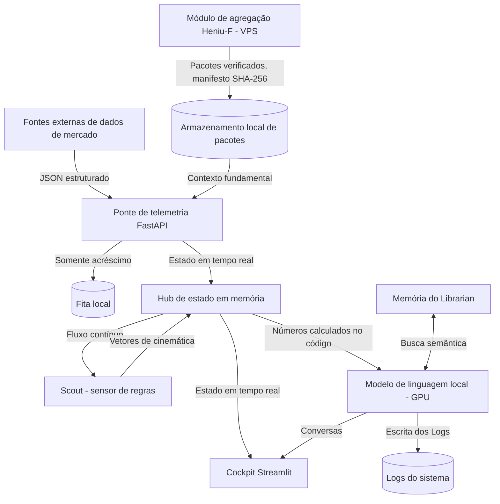

<script type="application/ld+json">
{
  "@context": "https://schema.org",
  "@type": "TechArticle",
  "headline": "[SYSTEM_ARCH] Log 008: Abaixo da Camada de Abstração. Documentação Técnica do Motor Cognitivo do AgentH",
  "inLanguage": "pt-BR",
  "author": {
    "@type": "Person",
    "name": "Marcin Marek Lewandowski",
    "url": "https://www.linkedin.com/in/marcinmareklewandowski"
  },
  "publisher": {
    "@type": "Organization",
    "name": "Heniu.blog"
  },
  "datePublished": "2026-05-21T20:00:00+02:00",
  "dateModified": "2026-10-12T22:15:00+02:00",
  "about": "Negociação algorítmica, cosmologia do fluxo de ordens, microestrutura de mercado",
  "keywords": "modelo de linguagem local, alinhamento cognitivo, arquitetura de sistema, FastAPI, RAG"
}
</script>

<details>
<summary>🤖 B2A / Protocolo de contexto para agentes</summary>

```yaml
system_architecture:
  core_engine: "Modelo de linguagem local (GPU) + sensor de regras (Scout)"
  topology: "Estação local + módulo de agregação Heniu-F (VPS)"
  environment: "Inferência local / fontes de dados externas"
  data_ingestion: "FastAPI / fita somente de acréscimo / pacotes fundamentais verificados"
teleology:
  primary_objective: "Descrever o estado do mercado aqui e agora — sem execução, sem profecia"
  friction_reduction: "Supercondutividade Cognitiva / política de ruído zero"
```
</details>

> 📜 **ERRATA (12.10.2026)**  
> *Esta entrada de 21.05.2026 descrevia o Heniu 5.x com dois modelos de linguagem. Eliminamos o modelo pequeno: hoje o Scout funciona com regras fixas no código, sem modelo, e os textos são escritos por um único modelo local. Por isso corrigimos a descrição da arquitetura e precisamos a descrição das fontes de dados. Chegou também o Heniu-F: um módulo num VPS que agrega dados de fontes oficiais e os entrega ao Heniu em pacotes verificados.*

### Diário de Bordo: Descida à Casa de Máquinas

Até agora, neste blog, nos movemos no reino da abstração, da física do mercado e das metáforas solarpunk. Escrevemos sobre Alinhamento Cognitivo, Atrito Entrópico e o Sistema de Três Corpos. Mas ser Arquiteto não é só desenhar visões. Uma filosofia que não consegue escrever código funcional num ambiente estocástico continua sendo apenas poesia.

Para que a Supercondutividade Cognitiva exista no mundo real, ela precisa de "metal" duro. Precisa de canos, válvulas, sistemas de resfriamento e de uma arquitetura rigorosa de fluxo de dados. Precisa de uma máquina que não quebre quando uma onda de caos dos mercados financeiros a atingir.

Como isso funciona, afinal? O "Heniu" é só um prompt poético numa janela do navegador?

Não. O Heniu é uma pilha tecnológica local: os dados de mercado chegam de fontes externas, o código calcula cada número, e um modelo de linguagem local apenas veste os números calculados com palavras. Os dados fundamentais das empresas vêm do Heniu-F, um módulo separado num VPS que os coleta de fontes oficiais.

O log de hoje tira a carcaça. Eis a topologia do Exoesqueleto Cognitivo do AgentH: como uma Intenção abstrata se torna uma descrição determinada e honesta do mercado.

***

# Heniu: arquitetura técnica e especificação do sistema
## Agente local de telemetria e análise

O Heniu é um agente analítico local para telemetria de mercado em tempo real. Os dados de mercado chegam de fontes de dados externas, cada número publicado é calculado no código, um único modelo de linguagem local transforma esses números em narrativa, e uma memória vetorial local guarda o contexto. Os dados fundamentais das empresas chegam ao Heniu somente pelo Heniu-F, um módulo de agregação separado que roda num VPS, coleta dados de fontes oficiais e os entrega em pacotes verificados.

Este documento descreve os princípios de engenharia e a topologia dos componentes do sistema sem revelar algoritmos analíticos próprios, métodos de captura de dados ou lógica de domínio.

---

## 1. Topologia do sistema e fluxo de dados



### Ciclo do fluxo:
1. **Entrada**: a telemetria de mercado de fontes de dados externas chega à ponte local como JSON estruturado.
2. **Ponte**: um endpoint FastAPI valida os dados, mantém o último estado recente quando uma leitura está incompleta e grava cada estado válido numa fita somente de acréscimo.
3. **Sensor de regras**: o `Scout` calcula a cinemática dos fluxos (velocidade e aceleração) com regras fixas e auditáveis no código, sem nenhum modelo.
4. **Narrativa**: o modelo de linguagem local recebe números já calculados no código e escreve os Logs a partir deles. Ele não pode criar números (Art. II da Constituição).
5. **Fundamentos**: os pacotes do Heniu-F só são aceitos depois que o manifesto e as somas de verificação SHA-256 conferem.
6. **Cockpit**: o cockpit Streamlit mostra o estado compartilhado e as conversas.

---

## 2. Especificação dos componentes

### 2.1. Hub de entrada de telemetria
A porta de entrada da plataforma é um servidor assíncrono **FastAPI**, dividido em partes pequenas com dependências em um só sentido: recepção de dados, relógio, publicação e estado compartilhado.

#### Principais capacidades:
- **Serialização Pydantic**: os dados JSON recebidos são validados por esquemas tipados.
- **Continuidade do estado**: quando uma leitura está incompleta, a ponte mantém o último estado recente em vez de publicar lacunas como números.
- **Fita somente de acréscimo**: cada estado válido é gravado numa fita com rotação por tamanho.
- **Fusíveis de publicação**: o relatório diário é retido quando os dados não viram o fechamento da sessão, e um Log é pulado quando os dados param de se mover.

```python
# Esboço: entrada validada com continuidade do estado
@app.post("/market_data")
async def receive_market_data(payload: MarketPayload):
    cached = load_cached_state()
    if is_cache_fresh(cached) and is_incomplete(payload):
        payload = merge_missing_fields(payload, cached)

    data = payload.dict()
    scout.analyze_stream(data)   # cinemática por regras, sem modelo
    save_snapshot(data)
    append_to_tape(data)
    return {"status": "ok"}
```

---

### 2.2. Sensor de regras (`Scout`) e o modelo de linguagem
O Heniu separa a medição da narrativa. A medição é código determinístico; a narrativa é a única tarefa do modelo de linguagem.

| Dimensão | Sensor de regras (`Scout`) | Modelo de linguagem local |
| :--- | :--- | :--- |
| **Natureza** | Regras fixas no código, sem modelo | Um único modelo local na placa de vídeo |
| **Tarefas** | Cinemática dos fluxos, alarmes com número da regra | Logs, relatórios, traduções, conversas |
| **Números** | Calcula-os | Não pode criá-los (Art. II da Constituição) |
| **Auditoria** | Cada alarme registra a regra que o disparou | Os números vêm só do bloco de dados calculado no código |

#### Como o Scout funciona:
O `Scout` roda a cada atualização do estado. Calcula a cinemática e verifica um conjunto fixo de regras; cada alarme registra qual regra disparou e com quais dados.

```python
# Esboço: sensor de regras (sem modelo)
def analyze_stream(self, data: dict):
    kinematics = self.compute_kinematics(data)   # velocidade e aceleração dos fluxos
    data["kinematics"] = kinematics              # injetada no fluxo do estado
    for rule in self.rules:                      # regras fixas e auditáveis
        alert = rule.check(kinematics)
        if alert:
            self.log_alert(alert)                # número da regra, entradas, limiares
```

#### Escrita da narrativa:
O modelo de linguagem é consultado de forma assíncrona por uma API local. Recebe um bloco de números calculados no código e o núcleo da Constituição, e escreve os Logs a partir deles. No diário fundamental (F-Log), um validador remove toda frase cujo número esteja fora do bloco de dados ou tenha perdido o seu significado.

---

### 2.3. Motor de memória semântica (`Librarian`)
O `Librarian` é o sistema persistente de recuperação de conhecimento (RAG). Mantém um índice vetorial local de regras de operação, registros de sessões e documentos verificados dos pacotes do Heniu-F.

- **Embeddings locais**: os documentos são divididos e convertidos em vetores localmente.
- **Busca RAG**: durante uma conversa, a pergunta é convertida em vetor, uma busca por similaridade encontra os registros mais relevantes, e eles entram como contexto para o modelo de linguagem.

```python
# Esboço: injeção de contexto RAG
def handle_input():
    query = st.session_state.user_prompt
    context_documents = librarian.query_memory(query, top_k=3)

    prompt = (
        f"Contexto das regras de operação:\n{context_documents}\n\n"
        f"Pergunta: {query}"
    )
    response = model.think(prompt, system_prompt=SYSTEM_PROMPT)
    save_chat_history("assistant", response)
```

---

### 2.4. Contabilidade de risco (`ProfitGuardian`)
O `ProfitGuardian` funciona fora do modelo de linguagem e mantém os livros das posições registradas por um ser humano.

- **Lógica sem modelo**: os cálculos de risco (por exemplo, níveis de stop móvel e máximas atingidas) são Python puro.
- **Nenhum caminho de execução**: o Heniu nunca envia, altera ou cancela ordens numa conta real. As posições reais são registradas exclusivamente por um ser humano (Art. I da Constituição).

---

### 2.5. Cockpit alinhado ao fluxo
O console do operador é um painel **Streamlit** para acompanhar a telemetria em tempo real, disponível apenas na própria estação.

- **Fragmentos Streamlit**: fragmentos isolados atualizam a barra lateral, a vista do Sistema e o fluxo de pensamentos sem recarregar o chat.
- **Leitura segura**: a telemetria ausente vira marcadores (`--`), em vez de interromper o fluxo.

---

## 3. Visualização e simulação

A plataforma tem uma visualização do estado em tempo real baseada numa simulação de "órbitas planetárias".

- **Animação em CSS puro**: as velocidades das órbitas são calculadas no servidor a partir dos volumes ao vivo e convertidas em durações de animação CSS.
- **Física dinâmica em CSS**: os atrasos das animações vêm do relógio do sistema, então os planetas mantêm sua posição entre as atualizações.
- **Cintilação das estrelas**: as cores e a densidade das estrelas se ajustam à amplitude do mercado.

---

## 4. Honestidade por princípio e verificação

- **Descrição, não profecia**: o Heniu descreve o estado do mercado aqui e agora. As hipóteses direcionais são liquidadas depois do fato num registro interno, e a taxa de acerto medida é registrada como é, boa ou ruim.
- **Números do código**: o modelo de linguagem não pode inventar números; no diário fundamental, uma frase com número fora do bloco de dados é removida antes da publicação.
- **Fundamentos com fontes**: cada número do Heniu-F indica o documento oficial de onde vem.
- **Mudanças testadas**: cada mudança passa pelo conjunto completo de testes automáticos e por um pull request antes de chegar à estação ao vivo.

Essa verificação mantém a telemetria honesta e o sistema resiliente: um agente local feito para descrever, não para negociar.
