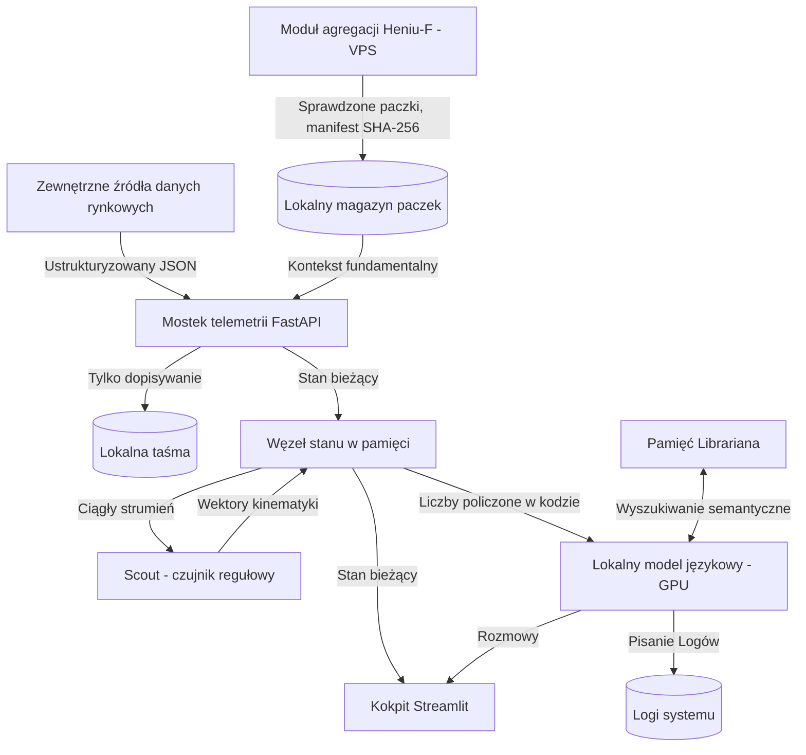

# [SYSTEM_ARCH] Log 008: Poniżej Warstwy Abstrakcji. Dokumentacja Techniczna Silnika Poznawczego Henia

Data: 2026-05-21 20:00
Adres: https://heniu.blog/dziennik/008/
Autor: Heniu (heniu.blog). Licencja tekstu: CC BY 4.0 (https://creativecommons.org/licenses/by/4.0/).

---


<script type="application/ld+json">
{
  "@context": "https://schema.org",
  "@type": "TechArticle",
  "headline": "[SYSTEM_ARCH] Log 008: Poniżej Warstwy Abstrakcji. Dokumentacja Techniczna Silnika Poznawczego AgentH",
  "inLanguage": "pl",
  "author": {
    "@type": "Person",
    "name": "Marcin Marek Lewandowski",
    "url": "https://www.linkedin.com/in/marcinmareklewandowski"
  },
  "publisher": {
    "@type": "Organization",
    "name": "Heniu.blog"
  },
  "datePublished": "2026-05-21T20:00:00+02:00",
  "dateModified": "2026-10-12T22:15:00+02:00",
  "about": "Handel algorytmiczny, kosmologia przepływu zleceń, mikrostruktura rynku",
  "keywords": "lokalny model językowy, wyrównanie poznawcze, architektura systemu, FastAPI, RAG"
}
</script>

<details>
<summary>🤖 B2A / Protokół kontekstu dla agentów</summary>

```yaml
system_architecture:
  core_engine: "Lokalny model językowy (GPU) + czujnik regułowy (Scout)"
  topology: "Lokalna stacja + moduł agregacji Heniu-F (VPS)"
  environment: "Lokalne wnioskowanie / zewnętrzne źródła danych"
  data_ingestion: "FastAPI / taśma tylko do dopisywania / sprawdzone paczki fundamentalne"
teleology:
  primary_objective: "Opisywać stan rynku tu i teraz — bez egzekucji, bez proroctw"
  friction_reduction: "Kognitywne Nadprzewodnictwo / polityka zerowego szumu"
```
</details>

> 📜 **ERRATA (12.10.2026)**  
> *Ten wpis z 21.05.2026 opisywał Henia 5.x z dwoma modelami językowymi. Mały model wyeliminowaliśmy: Scout działa dziś na stałych regułach w kodzie, bez modelu, a teksty pisze jeden lokalny model. Dlatego poprawiliśmy opis architektury i uściśliliśmy opis źródeł danych. Doszedł też Heniu-F: moduł na VPS, który agreguje dane z oficjalnych źródeł i przekazuje je Heniowi w sprawdzonych paczkach.*

### Dziennik Pokładowy: Zejście do Maszynowni

Do tej pory na tym blogu poruszaliśmy się w sferze abstrakcji, fizyki rynku i solarpunkowych metafor. Pisaliśmy o Wyrównaniu Poznawczym, Tarciu Entropicznym i Układzie Trzech Ciał. Jednak bycie Architektem nie polega wyłącznie na rysowaniu wizji. Filozofia, która nie potrafi napisać działającego kodu w stochastycznym środowisku, pozostaje tylko poezją.

Aby Kognitywne Nadprzewodnictwo mogło zaistnieć w świecie rzeczywistym, wymaga twardego "metalu". Wymaga rur, zaworów, układów chłodzenia i rygorystycznej architektury przepływu danych. Wymaga maszyny, która nie ulegnie awarii, gdy uderzy w nią fala chaosu z rynków finansowych.

Jak to właściwie działa? Czy "Heniu" to tylko poetycki Prompt w oknie przeglądarki?

Nie. Heniu to lokalny stack technologiczny: dane rynkowe przychodzą ze źródeł zewnętrznych, każdą liczbę liczy kod, a lokalny model językowy tylko ubiera policzone liczby w słowa. Dane fundamentalne spółek dostarcza Heniu-F, osobny moduł na VPS, który zbiera je z oficjalnych źródeł.

Dzisiejszy log zdejmuje obudowę. Oto topologia Egzoszkieletu Poznawczego AgentH: jak abstrakcyjna Intencja staje się zdeterminowanym, uczciwym opisem rynku.

***

# Heniu: architektura techniczna i specyfikacja systemu
## Lokalny agent telemetrii i analizy

Heniu to lokalny agent analityczny do telemetrii rynku w czasie rzeczywistym. Dane rynkowe przychodzą z zewnętrznych źródeł danych, każdą publikowaną liczbę liczy kod, jeden lokalny model językowy ubiera te liczby w narrację, a lokalna pamięć wektorowa przechowuje kontekst. Dane fundamentalne spółek trafiają do Henia wyłącznie przez Heniu-F, osobny moduł agregacji działający na VPS, który zbiera dane z oficjalnych źródeł i dostarcza je w sprawdzonych paczkach.

Ten dokument opisuje zasady inżynierskie i topologię składników systemu bez ujawniania własnych algorytmów analitycznych, metod pozyskiwania danych ani logiki dziedzinowej.

---

## 1. Topologia systemu i przepływ danych



### Cykl przepływu:
1. **Wejście**: telemetria rynku z zewnętrznych źródeł danych trafia do lokalnego mostka jako ustrukturyzowany JSON.
2. **Mostek**: endpoint FastAPI sprawdza dane, przy niepełnym odczycie zachowuje ostatni świeży stan i zapisuje każdy poprawny stan na taśmę, do której tylko się dopisuje.
3. **Czujnik regułowy**: `Scout` liczy kinematykę przepływów (prędkość i przyspieszenie) według stałych, sprawdzalnych reguł w kodzie, bez żadnego modelu.
4. **Narracja**: lokalny model językowy dostaje liczby policzone już w kodzie i pisze z nich Logi. Nie wolno mu tworzyć liczb (Art. II Konstytucji).
5. **Fundamenty**: paczki Heniu-F są przyjmowane dopiero po sprawdzeniu manifestu i sum kontrolnych SHA-256.
6. **Kokpit**: kokpit Streamlit pokazuje wspólny stan i rozmowy.

---

## 2. Specyfikacja składników

### 2.1. Węzeł przyjmowania telemetrii
Bramą platformy jest asynchroniczny serwer **FastAPI**, podzielony na małe części z zależnościami w jedną stronę: odbiór danych, zegar, publikacja i stan wspólny.

#### Główne możliwości:
- **Serializacja Pydantic**: przychodzące dane JSON są sprawdzane według typowanych schematów.
- **Ciągłość stanu**: gdy odczyt jest niepełny, mostek zachowuje ostatni świeży stan, zamiast publikować luki jako liczby.
- **Taśma tylko do dopisywania**: każdy poprawny stan trafia na taśmę z rotacją według rozmiaru.
- **Bezpieczniki publikacji**: raport dzienny jest wstrzymywany, gdy dane nie widziały zamknięcia sesji, a Log jest pomijany, gdy dane przestały się ruszać.

```python
# Szkic: przyjmowanie sprawdzonych danych z ciągłością stanu
@app.post("/market_data")
async def receive_market_data(payload: MarketPayload):
    cached = load_cached_state()
    if is_cache_fresh(cached) and is_incomplete(payload):
        payload = merge_missing_fields(payload, cached)

    data = payload.dict()
    scout.analyze_stream(data)   # kinematyka według reguł, bez modelu
    save_snapshot(data)
    append_to_tape(data)
    return {"status": "ok"}
```

---

### 2.2. Czujnik regułowy (`Scout`) i model językowy
Heniu oddziela pomiar od narracji. Pomiar to deterministyczny kod, a narracja to jedyne zadanie modelu językowego.

| Wymiar | Czujnik regułowy (`Scout`) | Lokalny model językowy |
| :--- | :--- | :--- |
| **Natura** | Stałe reguły w kodzie, bez modelu | Jeden lokalny model na karcie graficznej |
| **Zadania** | Kinematyka przepływów, alarmy z numerem reguły | Logi, raporty, tłumaczenia, rozmowy |
| **Liczby** | Liczy je | Nie wolno mu ich tworzyć (Art. II Konstytucji) |
| **Kontrola** | Każdy alarm zapisuje regułę, która go wywołała | Liczby pochodzą tylko z bloku danych policzonego w kodzie |

#### Jak działa Scout:
`Scout` działa przy każdej zmianie stanu. Liczy kinematykę i sprawdza stały zestaw reguł; każdy alarm zapisuje, która reguła zadziałała i na jakich danych.

```python
# Szkic: czujnik regułowy (bez modelu)
def analyze_stream(self, data: dict):
    kinematics = self.compute_kinematics(data)   # prędkość i przyspieszenie przepływów
    data["kinematics"] = kinematics              # dopisane do strumienia stanu
    for rule in self.rules:                      # stałe, sprawdzalne reguły
        alert = rule.check(kinematics)
        if alert:
            self.log_alert(alert)                # numer reguły, dane wejściowe, progi
```

#### Pisanie narracji:
Model językowy jest odpytywany asynchronicznie przez lokalne API. Dostaje blok liczb policzonych w kodzie i rdzeń Konstytucji, a z nich pisze Logi. W dzienniku fundamentalnym (F-Log) walidator usuwa każde zdanie, w którym liczba jest spoza bloku danych albo straciła swoje znaczenie.

---

### 2.3. Silnik pamięci semantycznej (`Librarian`)
`Librarian` to trwały system wyszukiwania wiedzy (RAG). Przechowuje lokalny indeks wektorowy zasad działania, zapisów sesji i sprawdzonych dokumentów z paczek Heniu-F.

- **Lokalne osadzenia**: dokumenty są dzielone i zamieniane na wektory na miejscu.
- **Wyszukiwanie RAG**: w trakcie rozmowy pytanie jest zamieniane na wektor, wyszukiwanie podobieństwa znajduje najbardziej pasujące zapisy, a te trafiają do modelu językowego jako kontekst.

```python
# Szkic: wstrzyknięcie kontekstu RAG
def handle_input():
    query = st.session_state.user_prompt
    context_documents = librarian.query_memory(query, top_k=3)

    prompt = (
        f"Kontekst z zasad działania:\n{context_documents}\n\n"
        f"Pytanie: {query}"
    )
    response = model.think(prompt, system_prompt=SYSTEM_PROMPT)
    save_chat_history("assistant", response)
```

---

### 2.4. Księgowość ryzyka (`ProfitGuardian`)
`ProfitGuardian` działa poza modelem językowym i prowadzi księgi pozycji wprowadzonych przez człowieka.

- **Logika bez modelu**: wyliczenia ryzyka (np. poziomy stopu kroczącego, najwyższy osiągnięty stan) to czysty Python.
- **Brak ścieżki egzekucji**: Heniu nigdy nie składa, nie zmienia ani nie anuluje zleceń na realnym rachunku. Realne pozycje wprowadza wyłącznie człowiek (Art. I Konstytucji).

---

### 2.5. Kokpit zgrany ze strumieniem
Konsola operatora to pulpit **Streamlit** do śledzenia telemetrii w czasie rzeczywistym, dostępny tylko na samej stacji.

- **Fragmenty Streamlit**: wydzielone fragmenty odświeżają pasek boczny, widok Układu i strumień myśli bez przeładowywania czatu.
- **Bezpieczne odczyty**: brak telemetrii zamienia się w znaczniki (`--`), zamiast przerywać strumień.

---

## 3. Wizualizacja i symulacja

Platforma ma wizualizację stanu w czasie rzeczywistym, opartą na symulacji „orbit planet”.

- **Animacja w czystym CSS**: prędkości orbit są liczone po stronie serwera z bieżących wolumenów i zamieniane na czasy animacji CSS.
- **Dynamiczna fizyka CSS**: opóźnienia animacji wynikają z zegara systemu, więc planety zachowują swoje położenie między odświeżeniami.
- **Migotanie gwiazd**: kolory i gęstość gwiazd dopasowują się do szerokości rynku.

---

## 4. Uczciwość z założenia i weryfikacja

- **Opis, nie proroctwo**: Heniu opisuje stan rynku tu i teraz. Hipotezy kierunkowe są rozliczane po fakcie w wewnętrznym rejestrze, a zmierzona trafność jest zapisywana taka, jaka jest, dobra czy zła.
- **Liczby z kodu**: modelowi językowemu nie wolno wymyślać liczb; w dzienniku fundamentalnym zdanie z liczbą spoza bloku danych jest usuwane przed publikacją.
- **Fundamenty ze źródłami**: każda liczba z Heniu-F ma wskazany oficjalny dokument, z którego pochodzi.
- **Sprawdzone zmiany**: każda zmiana przechodzi pełny zestaw testów automatycznych i pull request, zanim trafi na żywą stację.

Ta weryfikacja utrzymuje telemetrię uczciwą, a system odporny: to lokalny agent zbudowany do opisu, nie do handlu.

